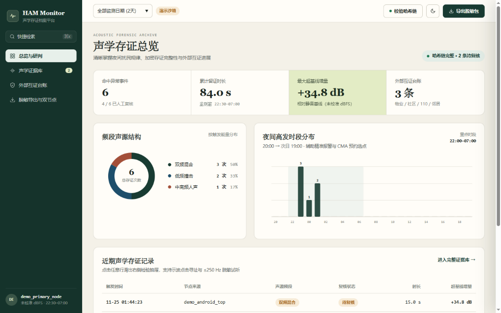
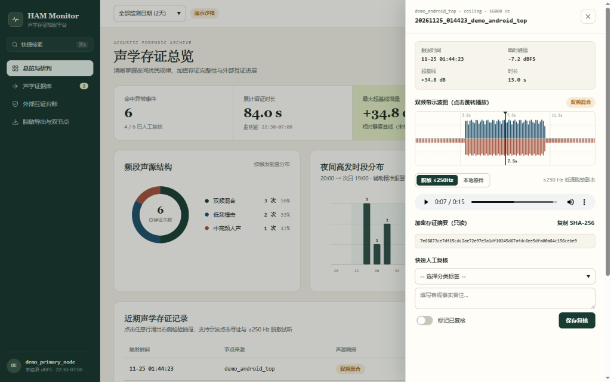
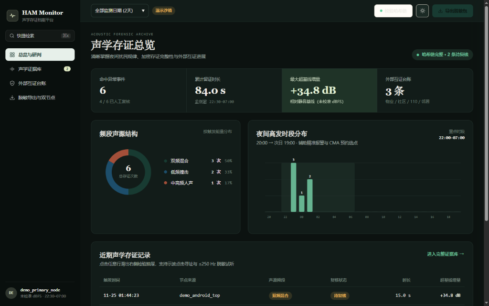
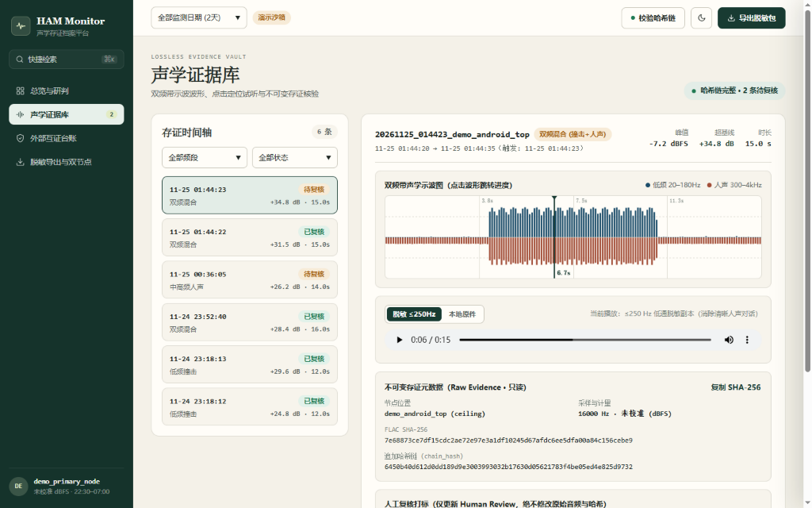
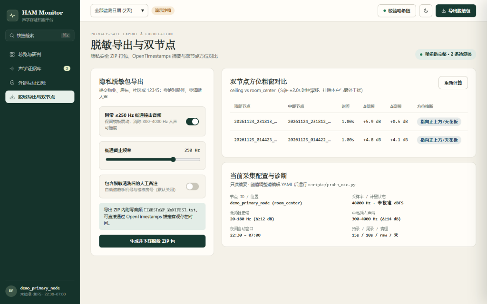

<div align="center">

# ham-monitor

**开源、100% 本地离线、隐私优先的室内被动声学监测与司法级存证平台**
将夜间主观的“楼上又在吵”，转化为**不可篡改、多维互证、可隐私脱敏外发**的结构化证据链。

[](LICENSE)
[](pyproject.toml)
[](SECURITY_AND_PRIVACY.md)
[](DESIGN.md)

<br />



<sub><strong>声学存证总览（Archival Ivory 日间卷宗纸主题）</strong> — 统一 4 格聚焦指标带、SVG 频段声源环图、24 小时夜间高发分布与可点击存证台账</sub>

</div>

---

## 界面预览（Showcase）

<table>
  <tr>
    <td width="50%" valign="top">
      <a href="docs/screenshots/02-forensic-drawer.png">
        
      </a>
      <p align="center"><sub><strong>右侧滑出存证检验抽屉</strong><br />点击表格任意行即刻展开：支持 HTTP 206 点击示波图寻址、默认 ≤250 Hz 脱敏试听、SHA-256 摘要与一键复核</sub></p>
    </td>
    <td width="50%" valign="top">
      <a href="docs/screenshots/05-overview-dark.png">
        
      </a>
      <p align="center"><sub><strong>深夜值守暗色模式（Nocturnal Forest）</strong><br />专为凌晨卧室低照度核查调校的哑光深森暗色，原生适配暗黑音频控件，不刺眼、低焦虑</sub></p>
    </td>
  </tr>
  <tr>
    <td width="50%" valign="top">
      <a href="docs/screenshots/03-evidence-vault.png">
        
      </a>
      <p align="center"><sub><strong>声学证据库（Artifacts 分栏工作台）</strong><br />双频带（20–180Hz 撞击 / 300–4kHz 人声）示波包络、脱敏/原件快速切换、不可变 FLAC SHA-256 与追加哈希链</sub></p>
    </td>
    <td width="50%" valign="top">
      <a href="docs/screenshots/04-export-dual-node.png">
        
      </a>
      <p align="center"><sub><strong>隐私脱敏导出 & Phase 2 双节点对比</strong><br />一键生成零绝对路径、零清晰人声的脱敏 ZIP（附 OpenTimestamps 哈希清单）及 ceiling vs room_center 能量差对照</sub></p>
    </td>
  </tr>
</table>

<details>
<summary>如何一键运行演示沙箱并更新文档截图？</summary>

```bash
# 启动隔离演示沙箱（自动生成合成双频样本，绝不触碰真实 data/evidence/）
python scripts/run_web.py --demo --port 8765
# 浏览器打开 http://127.0.0.1:8765，按 Ctrl+K 可呼出快捷命令面板
```

</details>

---

## 需求对齐：为什么需要这个项目？

长期夜间邻里噪声（楼板蹦跳、拖拽、深夜喊麦喧哗等）的真实困境，往往不只是“听得到噪音”，而是以下五个结构性痛点：

| 真实痛点 / 深层需求 | 传统做法的局限 | `ham-monitor` 的闭环方案 |
| --- | --- | --- |
| **夜间免内耗** | 半夜惊醒手动举手机录像，长期摧毁睡眠与情绪 | 夜间时间窗无人值守 + 15s 内存环形预录 + 连续事件自动合并，早间 2 分钟完成复核 |
| **孤证天花板** | 零散手机录音难以证明长期性与规律性，缺乏前置劝阻依据 | 追加式 SHA-256 哈希链 + 外部互证台账（物业劝阻 / 社区调解 / 110 回执 / 邻居证言）+ 标准化日报 |
| **声源归因盲区** | 剪力墙结构存在低频斜向传导，单麦易被质疑“是你自家或马路声” | 声源排查清单 + 双频带拆解 + Phase 2 `ceiling` vs `room_center` 双节点粗窗能量差对比 |
| **隐私传播反噬** | 直接把含清晰人声的录音发群或发给房东，易触碰隐私红线 | 双流分离（原件仅本地留底）+ 一键导出脱敏 ZIP 包（`≤250 Hz` 低通消除人声可懂度 + 路径/手机号/房号遮蔽） |
| **预算与设备门槛** | 一上来买专业声级计或砸吊顶投入大、性价比低 | Tier 0（闲置笔记本/旧安卓机 0 成本）→ Tier 1（百元 USB 麦/双节点）→ Tier 2（校准测量麦 + CMA 衔接） |

---

## 核心特性

- **双流分离与无损留证**：原始 PCM 经 15 秒环形缓冲直接写为单声道无损 `FLAC`（零滤波、零修改）；所有双频带滤波（`20–180 Hz` 低频撞击 / `300–4000 Hz` 人声）与 20% 分位数动态基线仅在隔离分析副本中运行。
- **防篡改哈希链 + 外部互证台账**：SQLite 严格隔离 `raw_evidence` / `algo_metrics` / `human_review`，每条事件写入 `SHA-256` 与链式 `chain_hash`，支持导出零音频 `TIMESTAMP_MANIFEST.txt` 供 OpenTimestamps 锚定存在时间。
- **隐私安全一键导出**：自动清除本机绝对路径，正则遮蔽备注中的手机号与房号，支持附带 8 阶零相位 `≤250 Hz` 低通撞击音频。
- **零构建依赖本地 Web 管理台（`v0.3`）**：FastAPI + 原生 ES Module 档案级工作台（默认仅监听 `127.0.0.1:8765`），内置 4 格聚焦指标带、SVG 频段环图、24 小时夜间高发分布图、右侧滑出存证检验抽屉、HTTP `206` 点击波形寻址示波器、默认脱敏试听器、`Ctrl+K` 快捷命令面板及日间卷宗纸 / 深夜森林暗色双主题。

---

## 文档导航

| 文档 | 内容说明 |
| --- | --- |
| [操作说明手册 (docs/OPERATIONS_GUIDE.md)](docs/OPERATIONS_GUIDE.md) | 多系统安装、Day 1 探针标定、夜间值守、早间 2 分钟复核 SOP、脱敏导出与排障 |
| [分级硬件选型指南 (docs/HARDWARE_TIERS.md)](docs/HARDWARE_TIERS.md) | Tier 0（0 成本）→ Tier 1（百元补强/双节点）→ Tier 2（专业校准与 CMA 衔接） |
| [问题边界与跨领域案例 (docs/PROBLEM_BOUNDARIES_AND_CASES.md)](docs/PROBLEM_BOUNDARIES_AND_CASES.md) | 声源归因盲区批判、孤证天花板、跨领域开源取证参考（NoiseCapture / ProofMode）与自查清单 |
| [架构与扩展契约 (docs/ARCHITECTURE.md)](docs/ARCHITECTURE.md) | 全栈分层架构、数据契约与 Phase 2/3 插件扩展点 |
| [前端设计系统 (DESIGN.md)](DESIGN.md) | 老钱档案级视觉 Token、排版层级、动效规范与双主题契约 |
| [数据安全与隐私红线 (SECURITY_AND_PRIVACY.md)](SECURITY_AND_PRIVACY.md) | 四条法律红线、脱敏自查清单与免责声明 |
| [现场实测模板 (docs/FIELD_TEST.md)](docs/FIELD_TEST.md) | 声学探针底噪与信噪比实测记录表 |

---

## 3 分钟快速开始

```bash
# 1. 创建虚拟环境并安装依赖（macOS 需先 brew install portaudio；Linux 需 libportaudio2 libsndfile1）
python3 -m venv .venv
source .venv/bin/activate        # Windows PowerShell: .\.venv\Scripts\Activate.ps1
pip install -r requirements.txt

# 2. 立即体验本地 Web 管理控制台（使用隔离演示沙箱，不触碰正式证据库）
python scripts/run_web.py --demo
# 浏览器打开 http://127.0.0.1:8765 （按 Ctrl+K 呼出快捷命令面板）

# 3. Day 1：检查麦克风并跑 60 秒现场声学探针
python scripts/probe_mic.py --list-devices
python scripts/probe_mic.py --duration 60

# 4. Day 2：前台试运行监测主循环（忽略夜间时间窗，Ctrl+C 优雅落盘）
python scripts/run_monitor.py --ignore-schedule
# 若使用 Mac mini/台式机 + 有线线控耳机麦（如 EarPods），推荐改用低频避工频模板（配合 caffeinate 防休眠）：
caffeinate -is python scripts/run_monitor.py --config config/profiles/tier0_wired_headset_mic.yaml -v

# 5. Day 3：macOS 安装每晚 22:30 自动启动的 launchd 定时任务
bash deploy/install_launchd.sh

# 6. 启动正式本地管理台（连接 config/default.yaml 对应的正式证据库）
python scripts/run_web.py
```

### 常用命令行工具

```bash
# 全库哈希链与 FLAC 完整性审计
python scripts/review_event.py --verify-chain

# 人工复核打标（仅改 human_review，不动原始证据）
python scripts/review_event.py --event-id <event_id> --label upstairs_impact --notes "已书面反馈物业"

# 录入物业 / 社区 / 110 / 邻居外部互证记录
python scripts/log_corroboration.py --category property_notice --ref "WY-01" --summary "管家已登门劝阻"

# 导出隐私脱敏 ZIP 分享包
python scripts/export_share.py --date 2026-11-25 --include-lowpass-audio

# 导入备用手机/录音笔整晚离线音频并做双节点方位对比
python scripts/import_audio.py --input night.wav --start-time "2026-11-25T23:00:00+08:00" --node-id sensor_ceiling --location-tag ceiling
python scripts/compare_nodes.py --date 2026-11-25
```

## 运行自动化测试

```bash
pytest -v
```
